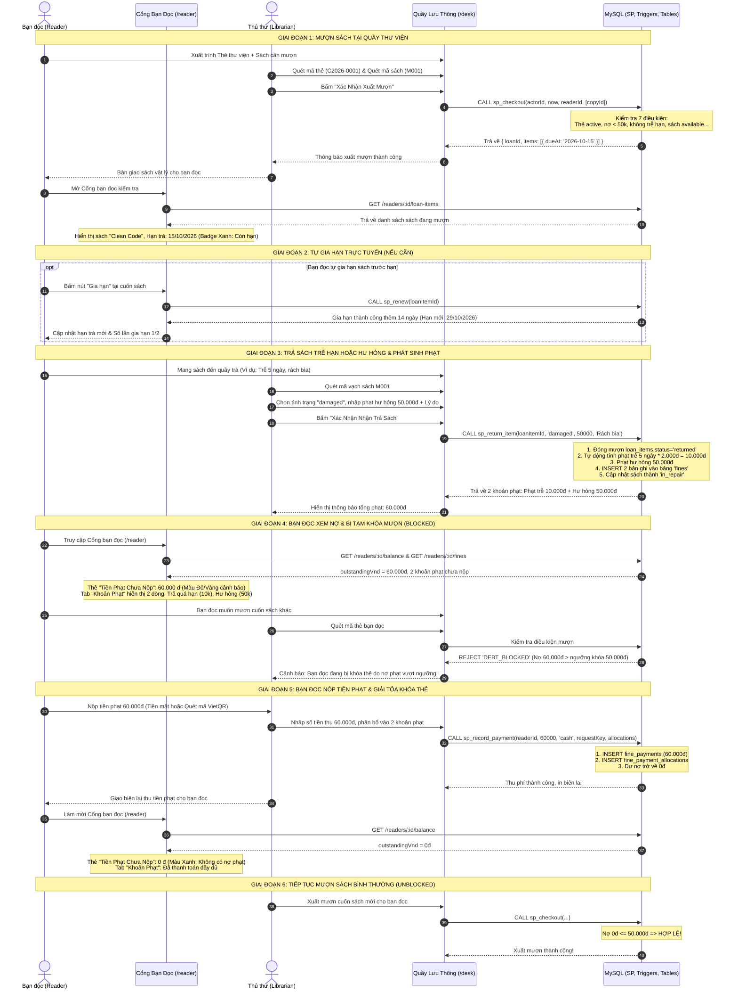

# TÀI LIỆU NGHIỆP VỤ: LƯU THÔNG MƯỢN TRẢ & XỬ LÝ PHẠT (UITLIB / NEXUSLIB)
## (BAO GỒM GÓC NHÌN BẠN ĐỌC & GÓC NHÌN THỦ THƯ/ADMIN)

> **Môn học**: Cơ sở Dữ liệu (CSDL) - Trường Đại học Công nghệ Thông tin (ĐHQG-HCM)  
> **Nguyên tắc cốt lõi**: Cơ sở dữ liệu MySQL 8.4 là Single Source of Truth. Toàn bộ logic kiểm tra hợp lệ, bảo toàn bất biến, tính toán tài chính và thay đổi trạng thái được thực thi trực tiếp thông qua **Stored Procedures**, **Triggers**, **Check Constraints** và **Unique Generated Columns**.

---

## MỤC LỤC
1. [Báo Cáo Tình Trạng Tích Hợp API & Quản Lý Phạt](#1-báo-cáo-tình-trạng-tích-hợp-api--quản-lý-phạt)
2. [Sơ Đồ Luồng Liên Hoàn: Mượn Sách $\rightarrow$ Trả Trễ/Hỏng $\rightarrow$ Phạt $\rightarrow$ Nộp Phạt $\rightarrow$ Giải Tỏa Nợ](#2-sơ-đồ-luồng-liên-hoàn-mượn-sách--trả-trễhỏng--phạt--nộp-phạt--giải-tỏa-nợ)
3. [Quy Trình Chi Tiết Dưới Góc Nhìn Bạn Đọc (Reader Journey & Portal `/reader`)](#3-quy-trình-chi-tiết-dưới-góc-nhìn-bạn-đọc-reader-journey--portal-reader)
   - 3.1. Giai đoạn 1: Tra cứu sách và Đặt trước giữ chỗ trực tuyến
   - 3.2. Giai đoạn 2: Nhận sách tại quầy & Theo dõi thời hạn mượn
   - 3.3. Giai đoạn 3: Tự gia hạn sách trực tuyến (Self-service Renew)
   - 3.4. Giai đoạn 4: Trả sách trễ hạn / hư hỏng & Nhận thông báo phạt
   - 3.5. Giai đoạn 5: Tình trạng bị tạm khóa mượn (Blocked State)
   - 3.6. Giai đoạn 6: Nộp tiền phạt & Tự động mở khóa mượn sách (Unblocked)
4. [Quy Trình Chi Tiết Dưới Góc Nhìn Thủ Thư & Quản Trị Viên (Staff Desk `/desk`)](#4-quy-trình-chi-tiết-dưới-góc-nhìn-thủ-thư--quản-trị-viên-staff-desk-desk)
   - 4.1. Thao tác xuất mượn sách (`sp_checkout`)
   - 4.2. Thao tác nhận trả & thẩm định tình trạng (`sp_return_item`)
   - 4.3. Thao tác ghi nhận mất sách (`sp_declare_lost`)
   - 4.4. Thao tác thu tiền phạt (`sp_record_payment`)
   - 4.5. Thao tác miễn giảm / điều chỉnh phạt (`sp_adjust_fine`)
5. [Chi Tiết Nghiệp Vụ Tiền Phạt, Công Thức & Dữ Liệu CSDL](#5-chi-tiết-nghiệp-vụ-tiền-phạt-công-thức--dữ-liệu-csdl)
   - 5.1. Các trường hợp phát sinh phạt
   - 5.2. Công thức tính tiền phạt và Đẳng thức tài chính
   - 5.3. Chi tiết các bảng và trường CSDL thay đổi khi xử lý phạt
6. [Chi Tiết Nghiệp Vụ Mượn Sách, Quy Tắc & Dữ Liệu CSDL](#6-chi-tiết-nghiệp-vụ-mượn-sách-quy-tắc--dữ-liệu-csdl)
   - 6.1. 7 điều kiện kiểm tra hợp lệ khi mượn sách
   - 6.2. Chi tiết các bảng và trường CSDL thay đổi khi mượn sách
7. [Bảng Tra Cứu Toàn Diện Trạng Thái & Stored Procedures](#7-bảng-tra-cứu-toàn-diện-trạng-thái--stored-procedures)

---

## 1. BÁO CÁO TÌNH TRẠNG TÍCH HỢP API & QUẢN LÝ PHẠT

### 1.1. Phân hệ Quản lý Phạt đã làm chưa?
* **Ở tầng CSDL (MySQL Database) & Backend API: ĐÃ HOÀN TẤT 100%**.
  * Toàn bộ nghiệp vụ phạt đã được lập trình chặt chẽ bằng Stored Procedures và Triggers chống gian lận:
    * `sp__assess_fines`: Tự động tính phạt trễ hạn theo ngày, chặn trần giá bồi hoàn; phạt hư hỏng; phạt mất sách.
    * `sp_record_payment`: Thu tiền phạt, phân bổ chi tiết vào từng khoản phạt, hỗ trợ chống thu trùng 2 lần bằng `request_key` (Idempotent).
    * `sp_adjust_fine`: Miễn giảm hoặc điều chỉnh tiền phạt có ghi nhận lý do và kiểm toán ký danh.
    * Các Trigger `trg_fines_bu`, `trg_fines_bd`, `trg_fine_adjustments_*`, `trg_fine_payments_*` đảm bảo nguyên tắc **Append-Only** (nghiêm cấm sửa/xóa tiền phạt và biên lai thu tiền đã ghi nhận).
  * Đầy đủ các API endpoints: `GET /readers/:id/fines`, `GET /readers/:id/balance`, `GET /readers/:id/payments`, `POST /payments`, `POST /fines/:id/adjustments`.
  * Đầy đủ các báo cáo kiểm toán tài chính: `sp_report_cumulative` (công nợ tích lũy) và `sp_report_rollforward` (luân chuyển nợ theo tháng).

* **Ở tầng Giao diện Người dùng (Frontend UI): ĐÃ TÍCH HỢP MỘT PHẦN**.
  * **Đã có trên UI**:
    * **Cổng bạn đọc (`/reader`)**: Bạn đọc xem được tổng nợ hiện tại, danh sách các khoản phạt phát sinh (lý do, tiền gốc, đã trả, còn nợ).
    * **Hồ sơ chi tiết bạn đọc (`/desk/readers/[id]`)**: Tab "Tiền phạt" hiển thị danh sách các khoản phạt và tổng nợ `outstandingVnd`.
    * **Quầy lưu thông (`/desk`)**: Khi thủ thư nhận trả sách quá hạn hoặc trả sách hư hỏng, hệ thống tự động gọi API và hiển thị thông báo khoản phạt phát sinh kèm mã phạt.
  * **Còn thiếu trên UI (Cần bổ sung giao diện thao tác)**:
    * Giao diện **Thu ngân / Nộp phạt** (`recordPayment`): Form nhập số tiền khách nộp, chọn phương thức (tiền mặt / chuyển khoản), tick chọn các khoản phạt cần thanh toán. (Hiện API này mới chỉ có nút test trong trang Dev `/dev/auth`).
    * Giao diện **Miễn giảm phạt** (`adjustFine`): Nút mở Modal cho phép Thủ thư/Admin nhập số tiền miễn giảm âm kèm lý do miễn giảm theo quyết định.
    * Bảng hiển thị **Lịch sử đóng tiền** (`readerPayments`): Liệt kê các biên lai thu tiền đã lập trước đây.

---

## 2. SƠ ĐỒ LUỒNG LIÊN HOÀN: MƯỢN SÁCH $\rightarrow$ TRẢ TRỄ/HỎNG $\rightarrow$ PHẠT $\rightarrow$ NỘP PHẠT $\rightarrow$ GIẢI TỎA NỢ

Sơ đồ thể hiện chu trình tương tác xuyên suốt giữa **Bạn đọc (Reader)**, **Cổng bạn đọc (`/reader`)**, **Thủ thư (Librarian)**, **Giao diện Quầy (`/desk`)** và **CSDL MySQL**:

---

## 3. QUY TRÌNH CHI TIẾT DƯỚI GÓC NHÌN BẠN ĐỌC (READER JOURNEY & PORTAL `/reader`)

Giao diện Cổng bạn đọc tại địa chỉ [`/reader`](file:///d:/qltt/uitlib/src/app/reader/page.tsx) là trung tâm thông tin cá nhân của người học/giảng viên:

### 3.1. Giai đoạn 1: Tra cứu sách và Đặt trước giữ chỗ trực tuyến
1. Bạn đọc truy cập Trang chủ hoặc Danh mục sách công khai (`/catalog`).
2. Tìm kiếm sách theo từ khóa (Tiêu đề, Tác giả, ISBN).
3. Bấm vào chi tiết sách (`/catalog/[id]`):
   - Nếu còn bản sao sẵn sàng (`available > 0`): Bạn đọc ghi lại vị trí kệ sách (`shelfCode`, ví dụ: *Kệ A1-01*) để đến thư viện lấy.
   - Nếu tất cả bản sao đều đang có người mượn (`available = 0`): Bạn đọc bấm nút **"Đặt trước" (Reserve)**. Hệ thống tự động xếp bạn đọc vào hàng đợi giữ chỗ (`status = 'waiting'`). Vị trí hàng đợi được hiển thị tại Cổng bạn đọc (Tab *Đặt trước: #1*).

### 3.2. Giai đoạn 2: Nhận sách tại quầy & Theo dõi thời hạn mượn
1. Bạn đọc đến quầy xuất trình thẻ thư viện. Thủ thư xuất mượn sách.
2. Ngay lập tức, bạn đọc đăng nhập Cổng bạn đọc (`/reader`):
   - Tab **"Sách Đang Mượn"** xuất hiện cuốn sách vừa mượn.
   - Hiển thị đầy đủ: Tên sách, Mã vạch bản sao (`barcode`), Ngày mượn, và **Ngày hết hạn trả**.
   - Trạng thái hạn trả:
     - **Còn hạn**: Hiển thị nhãn xanh lá (`Còn hạn`), đếm ngày còn lại.
     - **Quá hạn**: Hiển thị nhãn đỏ cảnh báo (`Quá hạn`), thông báo bạn đọc cần mang trả gấp.

### 3.3. Giai đoạn 3: Tự gia hạn sách trực tuyến (Self-service Renew)
1. Khi sắp đến ngày đáo hạn, bạn đọc có thể tự thao tác gia hạn ngay tại nhà trên Cổng bạn đọc (`/reader`) mà không cần đến quầy.
2. Tại dòng cuốn sách đang mượn, bạn đọc thấy số lần đã gia hạn (ví dụ: `0 / 2 lần`).
3. Bạn đọc bấm nút **"Gia hạn"**:
   - **Thành công**: Hạn trả tự động tăng thêm đúng chu kỳ mượn (ví dụ thêm 14 ngày đối với sinh viên). Hệ thống thông báo ngày hẹn trả mới.
   - **Bị từ chối**: Nút gia hạn bị vô hiệu hóa kèm thông báo rõ ràng trong các trường hợp:
     * Sách đã quá hạn (bắt buộc phải đem đến quầy).
     * Đã đạt số lần gia hạn tối đa (ví dụ đã gia hạn đủ 2 lần).
     * Cuốn sách này đang có bạn đọc khác xếp hàng đặt trước (hệ thống ưu tiên phục vụ người đang chờ).

### 3.4. Giai đoạn 4: Trả sách trễ hạn / hư hỏng & Nhận thông báo phạt
1. Khi bạn đọc mang sách đến trả trễ hạn hoặc làm hỏng sách:
2. Ngay khi thủ thư thao tác nhận trả tại quầy:
   - Cuốn sách chuyển từ tab **"Sách Đang Mượn"** sang tab **"Lịch Sử Mượn Trả"** với trạng thái *Đã trả*.
   - Khối thống kê trên cùng của trang: Thẻ **"Tiền Phạt Chưa Nộp"** chuyển từ 0đ sang số tiền màu cam/đỏ kèm ghi chú *"Cần nộp tại quầy thủ thư"*.
   - Tab **"Khoản Phạt"** hiển thị chi tiết:
     * Tên cuốn sách phát sinh phạt.
     * Lý do phạt: *Quá hạn* (kèm số ngày trễ) hoặc *Hư hỏng* (kèm lý do rách/bẩn).
     * Số tiền phạt gốc và số tiền còn nợ.

### 3.5. Giai đoạn 5: Tình trạng bị tạm khóa mượn (Blocked State)
Nếu bạn đọc có:
- Tổng tiền phạt chưa nộp $> 50.000$đ (đối với Sinh viên) hoặc $> 100.000$đ (đối với Giảng viên).
- Hoặc đang giữ 1 cuốn sách khác đã quá hạn chưa trả.
$\rightarrow$ Thẻ thư viện của bạn đọc bị hệ thống **tự động chặn quyền mượn sách mới** và chặn quyền đặt trước sách mới.

### 3.6. Giai đoạn 6: Nộp tiền phạt & Tự động mở khóa mượn sách (Unblocked)
1. Bạn đọc đến quầy thủ thư xuất trình thẻ và nộp tiền phạt (tiền mặt hoặc chuyển khoản ngân hàng qua mã QR).
2. Sau khi thủ thư bấm xác nhận thu tiền trên hệ thống:
   - Trên Cổng bạn đọc (`/reader`), mục **"Tiền Phạt Chưa Nộp"** lập tức nhảy về **0 đ** (màu xanh lá: *"Không có nợ phạt"*).
   - Trong tab "Khoản Phạt", cột Đã thanh toán hiển thị đủ 100% số tiền.
   - Bạn đọc lập tức được mở khóa quyền mượn sách mới ngay tại chỗ.

---

## 4. QUY TRÌNH CHI TIẾT DƯỚI GÓC NHÌN THỦ THƯ & QUẢN TRỊ VIÊN (STAFF DESK `/desk`)

Thủ thư thao tác nghiệp vụ thông qua Quầy lưu thông tại [`/desk`](file:///d:/qltt/uitlib/src/app/desk/page.tsx) và Quản lý bạn đọc tại [`/desk/readers/[id]`](file:///d:/qltt/uitlib/src/app/desk/readers/%5Bid%5D/page.tsx):

### 4.1. Thao tác xuất mượn sách (`sp_checkout`)
1. Thủ thư mở tab **"Xuất Mượn Sách"** tại `/desk`.
2. Quét mã thẻ độc giả (ví dụ: `C2026-0001`):
   - Màn hình hiển thị ngay: Tên độc giả, Loại độc giả, Hạn mức số sách được mượn, Số sách đang giữ và Tổng nợ phạt hiện tại.
   - Nếu thẻ hết hạn hoặc nợ phạt quá ngưỡng, hệ thống báo lỗi đỏ và không cho quét sách.
3. Quét mã vạch từng cuốn sách cần mượn (ví dụ: `M001`, `M004`):
   - Hệ thống hiển thị danh sách sách chuẩn bị xuất mượn kèm vị trí kệ.
4. Thủ thư bấm **"Xác Nhận Xuất Mượn"**:
   - Stored Procedure `sp_checkout` chạy giao dịch All-or-Nothing trong MySQL.
   - In ra kết quả thành công kèm hạn trả chi tiết cho từng cuốn để thủ thư nhắc nhở độc giả.

### 4.2. Thao tác nhận trả & thẩm định tình trạng (`sp_return_item`)
1. Thủ thư mở tab **"Trả Sách & Báo Mất"** tại `/desk` (hoặc mở trực tiếp nút *"Trả sách này"* trên hồ sơ bạn đọc `/desk/readers/[id]`).
2. Quét mã vạch cuốn sách cần trả:
   - Hệ thống hiển thị thông tin cuốn sách và mã lượt mượn đang mở.
3. Thẩm định tình trạng vật lý (3 nút chọn trực quan):
   - **Nguyên vẹn (good)**: Trả sách bình thường. Nếu trễ hạn, hệ thống tự tính tiền phạt trễ hạn. Sách chuyển thành `available` (hoặc chuyển thành `on_hold` nếu có người đang chờ đặt trước).
   - **Hơi cũ (worn)**: Tiếp nhận bình thường.
   - **Hư hỏng (damaged)**: Hệ thống mở ô nhập *Số tiền bồi thường hư hỏng (VNĐ)* và ô *Lý do hư hỏng* (bắt buộc). Sách được tự động chuyển sang trạng thái bảo dưỡng `in_repair`.
4. Bấm **"Xác Nhận Nhận Trả Sách"**: Hệ thống hoàn tất thủ tục và hiển thị chi tiết các khoản phạt phát sinh (nếu có).

### 4.3. Thao tác ghi nhận mất sách (`sp_declare_lost`)
1. Tại tab trả sách, nếu độc giả báo làm mất sách, thủ thư bấm nút đỏ **"Ghi Nhận Báo Mất"**.
2. Hệ thống gọi `sp_declare_lost`:
   - Tính phạt trễ hạn từ ngày đến hạn đến ngày báo mất.
   - Tính tiền bồi hoàn mất sách theo giá mua mới `replacement_cost_vnd` của cuốn sách.
   - Đánh dấu bản sao sách sang trạng thái `lost`.

### 4.4. Thao tác thu tiền phạt (`sp_record_payment`)
1. Thủ thư truy cập hồ sơ bạn đọc hoặc quầy thu ngân.
2. Kiểm tra danh sách các khoản phạt còn nợ của độc giả.
3. Chọn các khoản phạt cần thu, nhập số tiền thực thu và phương thức (`cash` hoặc `bank_transfer`).
4. Hệ thống gọi `sp_record_payment` kèm mã định danh Idempotent `request_key`.
5. Tiền được phân bổ chính xác vào từng khoản phạt, giảm trừ công nợ ngay lập tức.

### 4.5. Thao tác miễn giảm / điều chỉnh phạt (`sp_adjust_fine`)
1. Dành cho Quản trị viên hoặc Thủ thư được ủy quyền khi có quyết định miễn giảm (ví dụ: Miễn giảm cho sinh viên khó khăn, sự cố khách quan).
2. Nhập số tiền điều chỉnh âm (ví dụ: `-20.000` đ) và **bắt buộc nhập lý do văn bản**.
3. Hệ thống ghi nhật ký kiểm toán vào bảng `fine_adjustments`, tự động giảm số nợ của khoản phạt tương ứng.

---

## 5. CHI TIẾT NGHIỆP VỤ TIỀN PHẠT, CÔNG THỨC & DỮ LIỆU CSDL

### 5.1. Các trường hợp phát sinh phạt
1. **Phạt trả quá hạn (`fine_type = 'late'`)**: Phát sinh tự động khi trả sách trễ hơn `due_at`.
2. **Phạt hư hỏng tài liệu (`fine_type = 'damaged'`)**: Phát sinh khi trả sách ở tình trạng hư hại vật lý.
3. **Phạt bồi thường mất sách (`fine_type = 'lost'`)**: Phát sinh khi độc giả báo mất sách.

### 5.2. Công thức tính tiền phạt và Đẳng thức tài chính
* **Công thức phạt quá hạn**:
  $$\text{Số ngày trễ} = \max(0, \text{DATEDIFF}(\text{DateLocal}(p\_now), \text{DateLocal}(due\_at)))$$
  $$\text{Tiền phạt trễ} = \min\Big(\text{Số ngày trễ} \times \text{applied\_daily\_fee\_vnd}, \; \text{replacement\_cost\_vnd}\Big)$$
  *(Có trần chặn tối đa bằng giá bồi hoàn cuốn sách)*.

* **Đẳng thức tài chính bất biến**:
  $$\text{Dư nợ hiện tại} = \sum(\text{Phạt phát sinh}) + \sum(\text{Điều chỉnh}) - \sum(\text{Đã thanh toán})$$

### 5.3. Chi tiết các bảng và trường CSDL thay đổi khi xử lý phạt

| Bảng CSDL | Thao tác | Các trường (Fields) bị thay đổi / chèn mới | Điều kiện & Ý nghĩa nghiệp vụ |
| :--- | :---: | :--- | :--- |
| `fines` | **INSERT** | `loan_item_id`, `fine_type`, `default_amount_vnd`, `assessed_amount_vnd`, `reason`, `assessed_at`, `assessed_by_user_id` | Tạo khoản phạt mới (Append-Only, Trigger cấm Update/Delete). |
| `fine_adjustments` | **INSERT** | `fine_id`, `amount_vnd`, `reason`, `adjusted_by_user_id`, `adjusted_at` | Ghi nhận điều chỉnh/miễn giảm phạt. |
| `fine_payments` | **INSERT** | `reader_id`, `amount_vnd`, `method`, `request_key`, `paid_at`, `received_by_user_id` | Ghi nhận biên lai nộp tiền (Chống nộp trùng bằng `request_key`). |
| `fine_payment_allocations` | **INSERT** | `payment_id`, `fine_id`, `amount_vnd` | Phân bổ số tiền đóng vào từng khoản phạt. |
| `loan_items` | **UPDATE** | `status` = 'returned'/'lost', `returned_at`, `return_condition`, `lost_declared_at` | Đóng lượt mượn của cuốn sách. |
| `book_copies` | **UPDATE** | `physical_condition` = 'damaged', `circulation_status` = 'in_repair'/'lost', `updated_at` | Cập nhật hiện trạng sách trong kho. |
| `loans` | **UPDATE** | `status` = 'closed' | Tự động đóng phiếu mượn khi tất cả sách đã hoàn tất trả/mất. |

---

## 6. CHI TIẾT NGHIỆP VỤ MƯỢN SÁCH, QUY TẮC & DỮ LIỆU CSDL

### 6.1. 7 điều kiện kiểm tra hợp lệ khi mượn sách (`sp_checkout`)
Giao dịch sẽ **từ chối ngay lập tức (ROLLBACK & SIGNAL)** nếu vi phạm bất kỳ điều kiện nào sau đây:
1. `readers.status` phải là `active` (Không bị tạm khóa `suspended` hay `inactive`).
2. Có thẻ thư viện `library_cards` có `status = 'active'` và `expires_at > now`.
3. Sách có `circulation_status = 'available'` (hoặc `on_hold` đúng cho người mượn). Sách `damaged` không cho mượn.
4. Tổng nợ phạt hiện tại không vượt ngưỡng khóa thẻ `debt_block_threshold_vnd` (Sinh viên: 50.000đ).
5. Không đang giữ bất kỳ cuốn sách nào quá hạn (`due_at < now`).
6. Số sách đang mượn + sách mượn mới không vượt hạn mức `max_active_items` (Sinh viên: 5 cuốn, Giảng viên: 10 cuốn).
7. Tồn tại chính sách mượn `loan_policies` có hiệu lực tại thời điểm mượn.

### 6.2. Chi tiết các bảng và trường CSDL thay đổi khi mượn sách

| Bảng CSDL | Thao tác | Các trường (Fields) bị thay đổi / chèn mới | Điều kiện & Ý nghĩa nghiệp vụ |
| :--- | :---: | :--- | :--- |
| `loans` | **INSERT** | `reader_id`, `processed_by_user_id`, `borrowed_at`, `status` = 'open', `created_at` | Tạo phiếu mượn tổng. |
| `loan_items` | **INSERT** | `loan_id`, `copy_id`, `policy_id`, `borrowed_at`, `due_at`, `status` = 'on_loan', `renewal_count` = 0, `applied_loan_days`, `applied_max_renewals`, `applied_daily_fee_vnd` | Chi tiết cuốn sách mượn. Cột ảo `open_copy_id` kích hoạt **Unique Index** chống mượn trùng 2 lần. Chốt snapshot chính sách mượn. |
| `book_copies` | **UPDATE** | `circulation_status` = 'on_loan', `updated_at` = now | Chuyển trạng thái bản sao vật lý sang đang mượn. |
| `reservations` | **UPDATE** | `status` = 'fulfilled', `fulfilled_loan_item_id`, `closed_at` = now | Đánh dấu hoàn tất lượt đặt trước (nếu là sách đặt trước). |
| `loan_renewals` | **INSERT** | `loan_item_id`, `old_due_at`, `new_due_at`, `renewed_at`, `performed_by_user_id` | Ghi nhận nhật ký gia hạn thành công (khi gia hạn). |

---

## 7. BẢNG TRA CỨU TOÀN DIỆN TRẠNG THÁI & STORED PROCEDURES

| Mã lỗi (Error Key) | Ý nghĩa chi tiết | Phân hệ phát sinh |
| :--- | :--- | :--- |
| `READER_NOT_ACTIVE` | Tài khoản độc giả bị tạm khóa hoặc ngừng hoạt động | Mượn sách, Đặt trước |
| `CARD_INVALID` | Không có thẻ thư viện đang hoạt động và còn thời hạn | Mượn sách, Đặt trước |
| `DEBT_BLOCKED` | Tổng dư nợ tiền phạt vượt quá hạn mức tối đa cho phép (VD: > 50.000đ) | Mượn sách |
| `OVERDUE_BLOCKED` | Đang có ấn phẩm quá hạn chưa đem trả | Mượn sách |
| `LIMIT_REACHED` | Đạt hoặc vượt quá số lượng sách được phép mượn đồng thời | Mượn sách |
| `COPY_NOT_AVAILABLE`| Cuốn sách không ở trạng thái sẵn sàng (đang mượn hoặc giữ cho người khác) | Mượn sách |
| `FINE_RULE` | Mức phạt hư hỏng vượt giá sách, phạt mất sách sai quy cách, thiếu lý do | Trả sách, Báo mất, Điều chỉnh |
| `PAYMENT_EXCEEDS_DEBT`| Số tiền thanh toán lớn hơn tổng số nợ phạt hiện tại của độc giả | Thu tiền phạt |
| `ALLOCATION_MISMATCH`| Tiền phân bổ không bằng số tiền nộp hoặc nộp quá số dư của khoản phạt | Thu tiền phạt |
| `RENEWAL_REJECTED` | Không thể gia hạn do: Đã quá hạn, Hết lượt gia hạn, hoặc Có người đang chờ | Gia hạn sách |
| `APPEND_ONLY` | Vi phạm quy tắc bất biến: Nghiêm cấm sửa/xóa bảng tài chính & tiền phạt | Trigger CSDL |

---
*Tài liệu được cập nhật và kiểm chứng trực tiếp từ mã nguồn Drizzle Schema, MySQL Stored Procedures, API Contract và Vitest Suite của dự án UITLib.*
