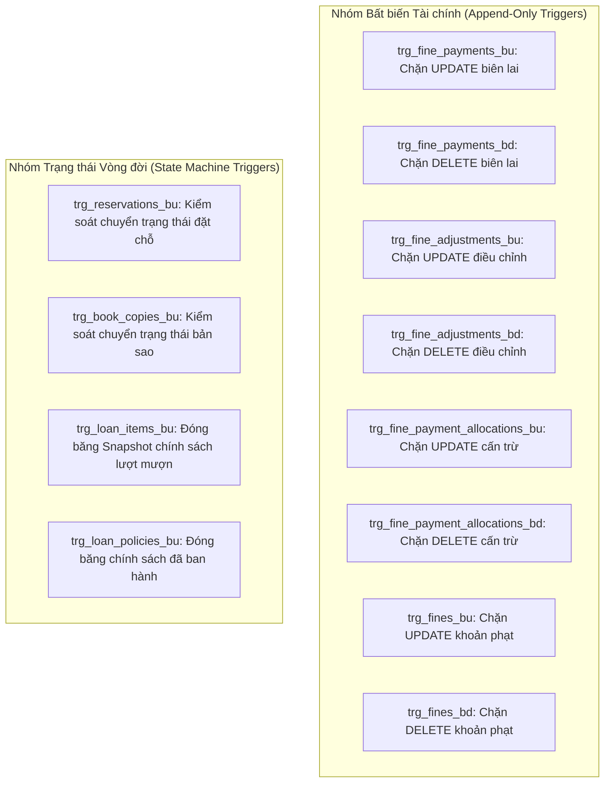
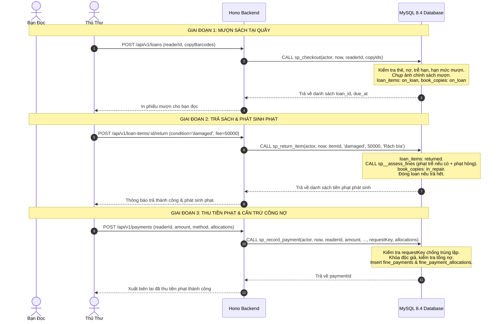

# TÀI LIỆU BÁCH KHOA TOÀN THƯ CƠ SỞ DỮ LIỆU NEXUSLIB / UITLIB
## Tổng Hợp Đầy Đủ: Kiến Trúc CSDL, 23 Stored Procedures, 8 Functions, 17 Triggers, 13 Views & Toàn Bộ Truy Vấn GET/POST

> **Hệ thống:** NexusLib / UITLib (Quản Lý Thư Viện Đại Học)  
> **Khóa học:** Cơ sở dữ liệu (CSDL) - Đại học Công nghệ Thông tin (UIT)  
> **Cơ sở dữ liệu:** MySQL 8.4 LTS (InnoDB, Strict SQL Mode, UTF8MB4)  
> **Nguyên tắc cốt lõi (Hiến pháp hệ thống):** *"Cơ sở dữ liệu là sản phẩm chính (The database is the product)"*. Mọi quy tắc nghiệp vụ, tính toán tiền tệ, lưu thông và tính toàn vẹn dữ liệu đều nằm trong MySQL. Backend TypeScript chỉ đóng vai trò ủy quyền, xác thực và gọi thủ tục, tuyệt đối không tự tái hiện nghiệp vụ ở tầng ứng dụng.

---

## MỤC LỤC CHI TIẾT

1. [Tổng Quan Kiến Trúc & Phân Quyền Bảo Mật CSDL](#1-tổng-quan-kiến-trúc--phân-quyền-bảo-mật-csdl)
2. [Chi Tiết 23 Stored Procedures (18 Public + 5 Internal)](#2-chi-tiết-23-stored-procedures)
   - [2.1. Nhóm Bản sao & Duy trì kho sách (2 SP)](#21-nhóm-bản-sao--duy-trì-kho-sách)
   - [2.2. Nhóm Thẻ thư viện & Độc giả (3 SP)](#22-nhóm-thẻ-thư-viện--độc-giả)
   - [2.3. Nhóm Chính sách mượn sách (2 SP)](#23-nhóm-chính-sách-mượn-sách)
   - [2.4. Nhóm Lưu thông Mượn - Trả - Gia hạn - Báo mất (4 SP)](#24-nhóm-lưu-thông-mượn---trả---gia-hạn---báo-mất)
   - [2.5. Nhóm Tiền phạt, Công nợ & Thu tiền (2 SP)](#25-nhóm-tiền-phạt-công-nợ--thu-tiền)
   - [2.6. Nhóm Đặt trước & Giữ chỗ sách (3 SP)](#26-nhóm-đặt-trước--giữ-chỗ-sách)
   - [2.7. Nhóm Báo cáo thống kê tài chính (2 SP)](#27-nhóm-báo-cáo-thống-kê-tài-chính)
   - [2.8. Nhóm Thủ tục nội bộ - Internal Helpers (5 SP)](#28-nhóm-thủ-tục-nội-bộ---internal-helpers)
3. [Chi Tiết 8 Stored Functions & 1 Event Scheduler](#3-chi-tiết-8-stored-functions--1-event-scheduler)
4. [Hệ Thống 17 Database Triggers Bảo Vệ Toàn Vẹn Dữ Liệu](#4-hệ-thống-17-database-triggers-bảo-vệ-toàn-vẹn)
5. [Ứng Dụng Cột Sinh Ảo (Generated Virtual Columns) Trong Độc Nhất & Khóa](#5-ứng-dụng-cột-sinh-ảo-generated-virtual-columns)
6. [Tổng Hợp Các Truy Vấn Đọc Dữ Liệu (GET Queries & Advanced SQL)](#6-tổng-hợp-các-truy-vấn-đọc-dữ-liệu-get-queries)
   - [6.1. Tra cứu sách với FULLTEXT SEARCH & UNION Derived Table](#61-tra-cứu-sách-với-fulltext-search--union-derived-table)
   - [6.2. Tính công nợ biến động bằng LEFT JOIN LATERAL](#62-tính-công-nợ-biến-động-bằng-left-join-lateral)
   - [6.3. Tính thứ tự hàng đợi chờ bằng Window Function ROW_NUMBER()](#63-tính-thứ-tự-hàng-đợi-chờ-bằng-window-function-rownumber)
   - [6.4. Tra cứu lưu thông & quét mã vạch tức thời](#64-tra-cứu-lưu-thông--quét-mã-vạch-tức-thời)
7. [Hệ Thống 13 Database Views (4 Báo Cáo Phân Tích + 9 Bất Biến Kiểm Toán)](#7-hệ-thống-13-database-views)
8. [Ma Trận Ánh Xạ Nghiệp Vụ End-to-End (Circulation & Money Lifecycle)](#8-ma-trận-ánh-xạ-nghiệp-vụ-end-to-end)

---

## 1. TỔNG QUAN KIẾN TRÚC & PHÂN QUYỀN BẢO MẬT CSDL

### 1.1. Mô hình Phân quyền Hai Tài khoản (Dual-Account Security)
Hệ thống không cho phép tài khoản ứng dụng Backend có toàn quyền thao tác tự do trên MySQL:

1. **Tài khoản Sở hữu CSDL (`DB_OWNER - root`):**
   - Chạy các migration tạo bảng, triggers, procedures, views, functions.
   - Định nghĩa các quyền và cấp quyền.
2. **Tài khoản Ứng dụng Backend (`DB_USER`):**
   - **Bảng được ghi trực tiếp (`APP_WRITABLE_TABLES`):** Chỉ gồm các bảng danh mục tĩnh hoặc dữ liệu tài khoản không có ràng buộc liên dòng phức tạp: `books`, `authors`, `publishers`, `categories`, `book_authors`, `book_categories`, `book_identifiers`, `readers`, `app_users`, `user_roles`.
   - **Bảng chỉ ghi qua Stored Procedures (`PROCEDURE_ONLY_TABLES`):** CẤM HOÀN TOÀN các lệnh trực tiếp `INSERT`, `UPDATE`, `DELETE` từ ứng dụng trên các bảng nhạy cảm: `book_copies`, `library_cards`, `loan_policies`, `loans`, `loan_items`, `loan_renewals`, `reservations`, `fines`, `fine_adjustments`, `fine_payments`, `fine_payment_allocations`. Mọi biến động đều bắt buộc gọi Stored Procedures.

### 1.2. Chiến lược Khóa Dữ Liệu Chống Deadlock (Global Lock Hierarchy)
Để ngăn ngừa tình trạng tranh chấp tài nguyên (Deadlock 1213) trong môi trường nhiều thủ thư và độc giả thao tác đồng thời, toàn bộ các Stored Procedures tuân thủ nghiêm ngặt **Thứ tự khóa toàn cục**:
$$\text{reader\_types} \longrightarrow \text{readers} \longrightarrow \text{library\_cards} \longrightarrow \text{books} \longrightarrow \text{book\_copies} \longrightarrow \text{loan\_policies} \longrightarrow \text{loans} \longrightarrow \text{loan\_items} \longrightarrow \text{reservations} \longrightarrow \text{fines}$$

---

## 2. CHI TIẾT 23 STORED PROCEDURES

### 2.1. Nhóm Bản sao & Duy trì kho sách

#### 1. `sp_register_copy` (Đăng ký nhập bản sao sách mới)
- **Phân loại:** Public | **Quyền yêu cầu:** `catalog.write`
- **Chữ ký:** `sp_register_copy(p_actor_user_id, p_now, p_book_id, p_barcode, p_shelf_code, p_acquired_at, p_condition, OUT p_copy_id)`
- **Nghiệp vụ:** 
  1. Kiểm tra quyền của thủ thư.
  2. Khóa dòng đầu sách `books` tương ứng (`SELECT id FROM books WHERE id = p_book_id FOR UPDATE`).
  3. Thêm dòng mới vào `book_copies` với trạng thái `available` (hoặc `in_repair` nếu sách nhập về bị hư hại).
  4. **Logic tự động nâng cao:** Nếu sách nguyên vẹn (`condition != 'damaged'`), thủ tục tự động gọi `sp__promote_queue(p_copy_id, ...)`: Nếu đang có bạn đọc xếp hàng chờ đặt trước đầu sách này, bản sao sẽ ngay lập tức được chuyển sang `on_hold` (giữ chỗ) và gán cho người đầu tiên trong hàng đợi.

#### 2. `sp_change_copy_status` (Bảo trì & đổi trạng thái bản sao)
- **Phân loại:** Public | **Quyền yêu cầu:** `catalog.write`
- **Chữ ký:** `sp_change_copy_status(p_actor_user_id, p_now, p_copy_id, p_target_status, p_condition)`
- **Nghiệp vụ:**
  1. Chỉ cho phép chuyển đổi giữa 3 trạng thái bảo trì: `available` (sẵn sàng), `in_repair` (đang sửa), `retired` (thanh lý).
  2. CẤM chuyển đổi nếu sách đang cho mượn (`on_loan`) hoặc đang giữ chỗ (`on_hold`) bằng thủ tục này.
  3. Khi sửa chữa xong đưa về `available`, tự động kích hoạt `sp__promote_queue` để ưu tiên cho hàng đợi đặt trước.

---

### 2.2. Nhóm Thẻ thư viện & Độc giả

#### 3. `sp_issue_card` (Cấp thẻ thư viện mới)
- **Phân loại:** Public | **Quyền yêu cầu:** `card.manage`
- **Chữ ký:** `sp_issue_card(p_actor_user_id, p_now, p_reader_id, p_card_number, p_expires_at, OUT p_card_id)`
- **Nghiệp vụ:**
  1. Khóa thông tin bạn đọc `readers FOR UPDATE`.
  2. Chèn thẻ mới vào `library_cards` với trạng thái `active`.
  3. **Ràng buộc toàn vẹn:** Cột sinh ảo `active_reader_id` kết hợp chỉ mục duy nhất `UNIQUE(active_reader_id)` đảm bảo một bạn đọc tại một thời điểm chỉ có DUY NHẤT 1 thẻ hoạt động. Nếu đang có thẻ cũ chưa hủy, lệnh sẽ tự động bị từ chối với lỗi `DUPLICATE`.

#### 4. `sp_set_card_status` (Hủy / Đổi trạng thái thẻ)
- **Phân loại:** Public | **Quyền yêu cầu:** `card.manage`
- **Chữ ký:** `sp_set_card_status(p_actor_user_id, p_now, p_card_id, p_status)`
- **Nghiệp vụ:**
  1. Chỉ cho phép chuyển từ `active` sang một trong 3 trạng thái cuối: `expired` (hết hạn), `lost` (báo mất), `revoked` (thu hồi thẻ).
  2. Đây là trạng thái kết thúc (Terminal State): Thẻ đã hủy không bao giờ được phép kích hoạt lại (muốn dùng phải cấp thẻ mới).

#### 5. `sp_expire_cards` (Quét hết hạn thẻ định kỳ)
- **Phân loại:** Public | **Quyền yêu cầu:** `card.manage`
- **Chữ ký:** `sp_expire_cards(p_actor_user_id, p_now, OUT p_count)`
- **Nghiệp vụ:** Mở Cursor duyệt qua danh sách các thẻ `active` có `expires_at <= p_now` để cập nhật trạng thái `expired`. Mỗi dòng xử lý trong một transaction độc lập để tránh khóa bảng kéo dài.

---

### 2.3. Nhóm Chính sách mượn sách

#### 6. `sp_create_policy_version` (Tạo phiên bản chính sách mượn)
- **Phân loại:** Public | **Quyền yêu cầu:** `policy.manage`
- **Chữ ký:** `sp_create_policy_version(p_actor_user_id, p_now, p_reader_type_id, p_material_type_id, p_max_active_items, p_loan_days, p_max_renewals, p_daily_late_fee_vnd, p_debt_block_threshold_vnd, p_valid_from, OUT p_policy_id)`
- **Nghiệp vụ:** Khóa cặp (đối tượng bạn đọc, loại tài liệu), kiểm tra không bị chồng lấn thời gian hiệu lực (`POLICY_OVERLAP`), chèn phiên bản chính sách mới.

#### 7. `sp_close_policy_version` (Đóng sớm phiên bản chính sách)
- **Phân loại:** Public | **Quyền yêu cầu:** `policy.manage`
- **Chữ ký:** `sp_close_policy_version(p_actor_user_id, p_now, p_policy_id, p_valid_to)`
- **Nghiệp vụ:** Cập nhật trường `valid_to`. Kiểm tra không được đóng lùi quá khứ trước các lượt mượn đã tham chiếu.

---

### 2.4. Nhóm Lưu thông Mượn - Trả - Gia hạn - Báo mất

#### 8. `sp_checkout` (Mượn sách tại quầy)
- **Phân loại:** Public | **Quyền yêu cầu:** `loan.checkout`
- **Chữ ký:** `sp_checkout(p_actor_user_id, p_now, p_reader_id, p_copy_ids JSON)`
- **Nghiệp vụ (Quy trình 7 bước toàn vẹn):**
  1. *Bước 0 (Pre-check):* Kiểm tra các bản sao đang ở trạng thái `on_hold`. Nếu đơn giữ chỗ của cuốn sách đã quá hạn 3 ngày, tự động gọi `sp__expire_hold` để hủy giữ chỗ ngay trước khi mượn.
  2. *Khóa dữ liệu:* Khóa `readers`, `library_cards`, `books`, `book_copies`, `loan_policies`.
  3. *Kiểm tra tính hợp lệ độc giả:* Thẻ phải `active` và còn hạn; hồ sơ không bị `suspended`; không có sách quá hạn chưa trả (`OVERDUE_BLOCKED`); tổng dư nợ hiện tại không vượt ngưỡng chặn (`DEBT_BLOCKED`).
  4. *Kiểm tra hạn mức mượn:* $\text{Số sách đang mượn} + \text{Số sách mượn thêm} \le \text{max\_active\_items}$.
  5. *Chụp ảnh chính sách (Policy Snapshot):* Tạo bản ghi `loans`, tạo các dòng `loan_items` đồng thời sao chép chính sách áp dụng tại thời điểm mượn (`applied_daily_fee_vnd`, `applied_max_renewals`) và tính hạn trả `due_at` qua hàm `fn_due_at`.
  6. *Xử lý đơn đặt trước:* Nếu cuốn sách được mượn bởi chính người đặt trước, đơn đặt chuyển sang `fulfilled` (hoàn tất).
  7. *Chuyển trạng thái:* `book_copies.circulation_status = 'on_loan'`.

#### 9. `sp_return_item` (Nhận trả một cuốn sách)
- **Phân loại:** Public | **Quyền yêu cầu:** `loan.return`
- **Chữ ký:** `sp_return_item(p_actor_user_id, p_now, p_loan_item_id, p_return_condition, p_damaged_fine_vnd, p_reason)`
- **Nghiệp vụ:**
  1. Khóa liên hoàn: `readers` $\to$ `books` $\to$ `book_copies` $\to$ `loans` $\to$ `loan_items`.
  2. Kiểm tra sách phải đang ở trạng thái `on_loan`.
  3. Cập nhật `loan_items`: `status = 'returned'`, `returned_at = p_now`, `return_condition = p_return_condition`.
  4. Gọi thủ tục nội bộ `sp__assess_fines`:
     - Nếu trả quá hạn (`p_now > due_at`): Tự động tính số ngày trễ và chèn phạt `late`.
     - Nếu sách hư hỏng (`damaged`): Chèn phạt `damaged` kèm số tiền đền bù và lý do.
  5. Điều phối bản sao:
     - Nếu `damaged`: Bản sao chuyển thành `in_repair`.
     - Nếu `good` hoặc `worn`: Bản sao chuyển thành `available` và kích hoạt `sp__promote_queue` (nếu có người đặt trước thì lập tức chuyển sang `on_hold`).
  6. Nếu tất cả các cuốn sách trong phiếu mượn đã trả hết, cập nhật `loans.status = 'closed'`.
  7. Trả về danh sách tiền phạt phát sinh.

#### 10. `sp_declare_lost` (Khai báo độc giả làm mất sách)
- **Phân loại:** Public | **Quyền yêu cầu:** `loan.return`
- **Chữ ký:** `sp_declare_lost(p_actor_user_id, p_now, p_loan_item_id, p_lost_fine_vnd, p_reason)`
- **Nghiệp vụ:** Cập nhật `loan_items.status = 'lost'`, `book_copies.circulation_status = 'lost'`. Tự động tính tiền phạt trễ hạn tính đến thời điểm báo mất + tiền phạt đền bù mất sách (mặc định lấy theo giá bìa `replacement_cost_vnd`).

#### 11. `sp_renew` (Gia hạn thời gian mượn)
- **Phân loại:** Public | **Quyền yêu cầu:** `loan.renew` (hoặc chính độc giả)
- **Chữ ký:** `sp_renew(p_actor_user_id, p_now, p_loan_item_id, OUT p_new_due_at)`
- **Nghiệp vụ:**
  1. Kiểm tra sách phải đang mượn (`on_loan`), chưa quá hạn (`p_now <= due_at`), và số lần gia hạn chưa chạm trần (`renewal_count < applied_max_renewals`).
  2. **Quy tắc công bằng thư viện:** Nếu đầu sách này **đang có độc giả khác xếp hàng chờ đặt trước (`reservations.status = 'waiting'`)**, hệ thống sẽ TỪ CHỐI GIA HẠN (`RENEWAL_REJECTED: reserved`) để ưu tiên sách cho người chờ.
  3. Tăng `renewal_count = renewal_count + 1`, gia hạn thêm số ngày quy định và lưu vết vào `loan_renewals`.

---

### 2.5. Nhóm Tiền phạt, Công nợ & Thu tiền

#### 12. `sp_record_payment` (Ghi nhận thu tiền & phân bổ cấn trừ nợ)
- **Phân loại:** Public | **Quyền yêu cầu:** `fine.collect`
- **Chữ ký:** `sp_record_payment(p_actor_user_id, p_now, p_reader_id, p_amount_vnd, p_method, p_reference_no, p_request_key, p_allocations JSON, OUT p_payment_id, OUT p_replayed)`
- **Nghiệp vụ:**
  1. *Kiểm tra Idempotency:* Dựa vào `p_request_key` (UUID). Nếu khóa giao dịch đã tồn tại, gọi `sp__check_replay` để xác nhận giao dịch cũ (trả về kết quả cũ, `p_replayed = TRUE`), ngăn chặn tuyệt đối lỗi trừ tiền 2 lần khi mạng lag.
  2. *Kiểm tra phân bổ:* Khóa `readers`, kiểm tra tổng số tiền nợ còn lại. Đảm bảo $\sum \text{tiền phân bổ} = \text{số tiền thu}$ (`ALLOCATION_MISMATCH`) và không thu vượt quá tổng dư nợ (`PAYMENT_EXCEEDS_DEBT`).
  3. Ghi nhận biên lai vào `fine_payments` và ghi chi tiết trừ nợ từng khoản vào `fine_payment_allocations`.

#### 13. `sp_adjust_fine` (Điều chỉnh / Miễn giảm tiền phạt)
- **Phân loại:** Public | **Quyền yêu cầu:** `fine.adjust`
- **Chữ ký:** `sp_adjust_fine(p_actor_user_id, p_now, p_fine_id, p_amount_vnd, p_reason, OUT p_adjustment_id)`
- **Nghiệp vụ:** 
  - `p_amount_vnd < 0`: Miễn giảm bớt tiền phạt.
  - `p_amount_vnd > 0`: Phạt bổ sung.
  - Bắt buộc có lý do (`p_reason`) phục vụ kiểm toán tài chính.
  - Không cho phép giảm làm số tiền phạt thực tế nhỏ hơn số tiền độc giả đã đóng.

---

### 2.6. Nhóm Đặt trước & Giữ chỗ sách

#### 14. `sp_reserve` (Đặt trước đầu sách hết bản sao)
- **Phân loại:** Public | **Quyền yêu cầu:** Độc giả (chính chủ) hoặc `reservation.manage`
- **Chữ ký:** `sp_reserve(p_actor_user_id, p_now, p_reader_id, p_book_id, OUT p_reservation_id)`
- **Nghiệp vụ:** 
  - Chỉ cho phép đặt khi trên giá không còn cuốn nào sẵn sàng (`available = 0`).
  - Độc giả phải có thẻ hợp lệ, không bị tạm khóa, và không đang mượn cuốn sách này.
  - Chèn yêu cầu vào `reservations` với trạng thái `waiting`.

#### 15. `sp_cancel_reservation` (Hủy yêu cầu đặt trước)
- **Phân loại:** Public | **Quyền yêu cầu:** Độc giả hoặc `reservation.manage`
- **Chữ ký:** `sp_cancel_reservation(p_actor_user_id, p_now, p_reservation_id, p_reason)`
- **Nghiệp vụ:** Chuyển trạng thái sang `cancelled`. Nếu đơn đặt đang ở trạng thái `ready` (sách đang giữ trên kệ), thủ tục tự động gọi `sp__promote_queue` để nhường ngay cuốn sách cho người chờ kế tiếp.

#### 16. `sp_expire_holds` (Quét hết hạn đơn giữ chỗ)
- **Phân loại:** Public | **Quyền yêu cầu:** `reservation.manage`
- **Chữ ký:** `sp_expire_holds(p_actor_user_id, p_now, OUT p_count)`
- **Nghiệp vụ:** Kiểm tra quyền thủ thư và kích hoạt thủ tục quét batch cursor `sp__expire_holds_batch`.

---

### 2.7. Nhóm Báo cáo thống kê tài chính

#### 17. `sp_report_cumulative` (Báo cáo tích lũy tài chính)
- **Chữ ký:** `sp_report_cumulative(p_as_of DATETIME(3), p_reader_id BIGINT)`
- **Nghiệp vụ:** Thống kê tổng tiền phạt phát sinh, tổng điều chỉnh miễn giảm, tổng tiền đã thu và số dư nợ còn lại tính đến mốc thời gian `p_as_of`.

#### 18. `sp_report_rollforward` (Báo cáo biến động nợ theo kỳ)
- **Chữ ký:** `sp_report_rollforward(p_from DATETIME(3), p_to DATETIME(3), p_reader_id BIGINT)`
- **Nghiệp vụ:** Thống kê số dư nợ đầu kỳ, số phạt phát sinh trong kỳ, miễn giảm trong kỳ, thực thu trong kỳ và số dư nợ cuối kỳ.

---

### 2.8. Nhóm Thủ tục nội bộ - Internal Helpers (Không cấp quyền ngoài)

#### 19. `sp__check_replay`
- Nhiệm vụ: So khớp giao dịch thu tiền phạt cũ khi bị trùng `request_key`.

#### 20. `sp__assess_fines`
- Nhiệm vụ: Tính số ngày trễ, gọi hàm `fn_days_late` và `fn_late_fee` để chèn bản ghi phạt `late`, `damaged` hoặc `lost`.

#### 21. `sp__promote_queue`
- Nhiệm vụ: Thuật toán cốt lõi của tính năng Hold Queue (FIFO). Tìm người chờ đầu tiên của đầu sách (`waiting`), kiểm tra tính hợp lệ; nếu đạt, chuyển sách sang `on_hold`, chuyển đơn đặt sang `ready` và cấp thời hạn giữ chỗ 3 ngày (`hold_expires_at = p_now + INTERVAL 3 DAY`).

#### 22. `sp__expire_hold`
- Nhiệm vụ: Hủy 1 đơn giữ chỗ quá hạn 3 ngày trong một Transaction độc lập riêng biệt (`status = 'expired'`), sau đó lập tức gọi `sp__promote_queue` để nhường bản sao cho người kế tiếp.

#### 23. `sp__expire_holds_batch`
- Nhiệm vụ: Con trỏ Cursor quét toàn bộ các đơn đặt `ready` đã quá hạn 3 ngày để gọi `sp__expire_hold`. Được gọi định kỳ bởi MySQL Event `ev_expire_holds`.

---

## 3. CHI TIẾT 8 STORED FUNCTIONS & 1 EVENT SCHEDULER

### 3.1. Danh sách 8 Stored Functions

| Tên Hàm | Tham số đầu vào | Giá trị trả về | Đặc tính | Chức năng nghiệp vụ |
|---|---|---|---|---|
| `fn_local_date` | `p_ts DATETIME(3)` | `DATE` | DETERMINISTIC | Quy đổi mốc thời gian UTC sang ngày lịch địa phương theo múi giờ Việt Nam (`UTC+07:00`). |
| `fn_due_at` | `p_borrowed_at, p_loan_days` | `DATETIME(3)` | DETERMINISTIC | Tính mốc hạn trả chính xác: thời điểm 23:59:59.999 local của ngày đáo hạn, sau đó quy đổi ngược lại UTC. |
| `fn_days_late` | `p_due_at, p_end_at` | `INT` | DETERMINISTIC | Tính số ngày trễ hạn nguyên vẹn: $\max(0, \text{DATEDIFF}(\text{ngày kết thúc}, \text{ngày hạn trả}))$. |
| `fn_late_fee` | `p_days, p_daily_fee, p_cap` | `BIGINT` | DETERMINISTIC | Tính tiền phạt quá hạn: $\min(p\_days \times p\_daily\_fee, p\_cap)$ (tiền phạt không vượt quá trần giá trị sách). |
| `fn_has_permission`| `p_user_id, p_code` | `BOOLEAN` | READS SQL DATA | Kiểm tra tài khoản có đang `active` và có vai trò chứa quyền `p_code` hay không. |
| `fn_fine_net` | `p_fine_id` | `BIGINT` | READS SQL DATA | Tính số tiền phạt thực tế sau điều chỉnh: $\text{Số tiền phạt gốc} + \sum \text{điều chỉnh}$. |
| `fn_fine_remaining`| `p_fine_id` | `BIGINT` | READS SQL DATA | Tính số tiền còn nợ của khoản phạt: $\text{fine\_net} - \sum \text{tiền đã nộp cấn trừ}$. |
| `fn_reader_outstanding` | `p_reader_id, p_as_of` | `BIGINT` | READS SQL DATA | Tính tổng dư nợ của bạn đọc tại một thời điểm `p_as_of` phục vụ báo cáo và kiểm toán. |

### 3.2. Scheduled Event: `ev_expire_holds`
- **Cú pháp:**
  ```sql
  CREATE EVENT `ev_expire_holds`
  ON SCHEDULE EVERY 15 MINUTE
  ON COMPLETION PRESERVE ENABLE
  DO CALL sp__expire_holds_batch(UTC_TIMESTAMP(3), @expired_count);
  ```
- **Ý nghĩa:** Chạy ngầm mỗi **15 phút một lần**, tự động thu hồi các cuốn sách giữ chỗ mà độc giả không đến nhận sau 3 ngày, tự động chuyển sách cho người chờ kế tiếp trong hàng đợi.

---

## 4. HỆ THỐNG 17 DATABASE TRIGGERS BẢO VỆ TOÀN VẸN

Hệ thống cài đặt 17 Trigger để ngăn chặn mọi hành vi gian lận dữ liệu hoặc lỗi ứng dụng:



1. **`trg_fine_payments_bu` & `trg_fine_payments_bd`:** Bảng biên lai thu tiền là **Append-Only**. Nghiêm cấm mọi hành vi `UPDATE` hoặc `DELETE` dòng tiền đã thu.
2. **`trg_fine_adjustments_bu` & `trg_fine_adjustments_bd`:** Không cho phép sửa/xóa các dòng điều chỉnh miễn giảm đã ghi nhận.
3. **`trg_fine_payment_allocations_bu` & `trg_fine_payment_allocations_bd`:** Không cho phép sửa/xóa chi tiết phân bổ thanh toán.
4. **`trg_fines_bu` & `trg_fines_bd`:** Khoản phạt khi đã tạo thì không được sửa đổi số tiền gốc hay xóa bỏ; muốn thay đổi phải thông qua bảng `fine_adjustments`.
5. **`trg_loan_items_bu`:** Đóng băng Snapshot chính sách: Sau khi đã mượn, không ai được phép sửa đổi `loan_id`, `copy_id`, `borrowed_at`, `due_at`, `applied_daily_fee_vnd`...
6. **`trg_reservations_bu`:** Máy trạng thái hữu hạn (State Machine) cho đơn đặt trước: Chỉ cho phép chuyển `waiting` $\to$ `ready`/`cancelled` và `ready` $\to$ `fulfilled`/`expired`/`cancelled`. Cấm đổi `reader_id` hay `book_id`.
7. **`trg_book_copies_bu`:** Ngăn chặn đặt trạng thái sách về `available` nếu tình trạng sách là `damaged` (hư hỏng).
8. **`trg_loan_policies_bu`:** Chính sách mượn một khi đã ban hành thì không được sửa đổi thông số nghiệp vụ; muốn đổi phải ban hành phiên bản mới qua `sp_create_policy_version`.

---

## 5. ỨNG DỤNG CỘT SINH ẢO (GENERATED VIRTUAL COLUMNS)

Một trong những thiết kế cơ sở dữ liệu xuất sắc nhất của hệ thống là sử dụng **Virtual Generated Columns** kết hợp với **Chỉ mục duy nhất (Unique Index)** để giải quyết bài toán toàn vẹn logic phức tạp mà thông thường phải tốn rất nhiều câu lệnh khóa:

| Bảng | Tên cột sinh ảo | Biểu thức tạo cột (Generated Expression) | Chỉ mục duy nhất áp dụng | Ý nghĩa nghiệp vụ đạt được |
|---|---|---|---|---|
| `library_cards` | `active_reader_id` | `IF(status = 'active', reader_id, NULL)` | `UNIQUE KEY (active_reader_id)` | **Một độc giả chỉ có tối đa 1 thẻ active.** Các thẻ hết hạn mang giá trị `NULL` nên không bị trùng lặp. |
| `loan_items` | `open_copy_id` | `IF(status = 'on_loan', copy_id, NULL)` | `UNIQUE KEY (open_copy_id)` | **Một bản sao sách chỉ được cho mượn bởi 1 người tại một thời điểm.** |
| `reservations` | `ready_copy_id` | `IF(status = 'ready', assigned_copy_id, NULL)` | `UNIQUE KEY (ready_copy_id)` | **Một cuốn sách trên kệ giữ chỗ chỉ được gán cho duy nhất 1 độc giả.** |
| `reservations` | `active_reader_id`| `IF(status IN ('waiting','ready'), reader_id, NULL)` | `UNIQUE KEY (book_id, active_reader_id)` | **Một bạn đọc không thể đặt trùng 2 lần cho cùng một đầu sách.** |

---

## 6. TỔNG HỢP CÁC TRUY VẤN ĐỌC DỮ LIỆU (GET QUERIES)

### 6.1. Tra cứu sách với FULLTEXT SEARCH & UNION Derived Table
```sql
-- Tìm kiếm đa tiêu chí kết hợp chỉ mục toàn văn và chỉ mục tiền tố
SELECT b.id, b.title, b.subtitle, b.published_year, b.cover_url,
       mt.code AS material_type, p.name AS publisher_name
  FROM books b
  JOIN material_types mt ON mt.id = b.material_type_id
  LEFT JOIN publishers p ON p.id = b.publisher_id
  JOIN (
    -- Nhánh 1: Tận dụng FULLTEXT INDEX trên title, subtitle
    SELECT id FROM books 
     WHERE MATCH(title, subtitle) AGAINST ('Clean* Code*' IN BOOLEAN MODE)
    UNION 
    -- Nhánh 2: Tận dụng B-TREE INDEX trên authors.name
    SELECT ba.book_id 
      FROM authors a 
      JOIN book_authors ba ON ba.author_id = a.id
     WHERE a.name LIKE CONCAT('Clean Code', '%')
  ) m ON m.id = b.id
 WHERE b.status = 'active'
 ORDER BY b.title, b.id
 LIMIT 20 OFFSET 0;
```

### 6.2. Tính công nợ biến động bằng `LEFT JOIN LATERAL`
```sql
-- Lấy chi tiết từng khoản phạt kèm tổng điều chỉnh và tổng đã thanh toán
SELECT f.id AS fine_id, f.fine_type, f.assessed_amount_vnd, b.title,
       adj.s AS adjustments_vnd,
       al.s  AS allocated_vnd,
       (f.assessed_amount_vnd + adj.s - al.s) AS remaining_vnd
  FROM fines f
  JOIN loan_items li ON li.id = f.loan_item_id
  JOIN loans l ON l.id = li.loan_id
  JOIN book_copies bc ON bc.id = li.copy_id
  JOIN books b ON b.id = bc.book_id
  LEFT JOIN LATERAL (
    SELECT COALESCE(SUM(a.amount_vnd), 0) AS s 
      FROM fine_adjustments a 
     WHERE a.fine_id = f.id
  ) adj ON TRUE
  LEFT JOIN LATERAL (
    SELECT COALESCE(SUM(x.amount_vnd), 0) AS s 
      FROM fine_payment_allocations x 
     WHERE x.fine_id = f.id
  ) al ON TRUE
 WHERE l.reader_id = :readerId
 ORDER BY f.assessed_at DESC;
```

### 6.3. Tính thứ tự hàng đợi chờ bằng Window Function `ROW_NUMBER()`
```sql
SELECT r.id, r.reader_id, b.title, r.status, r.requested_at, 
       q.queue_position, r.ready_at, r.hold_expires_at
  FROM reservations r
  JOIN books b ON b.id = r.book_id
  LEFT JOIN (
    SELECT id, 
           ROW_NUMBER() OVER (
             PARTITION BY book_id 
             ORDER BY requested_at, id
           ) AS queue_position
      FROM reservations 
     WHERE status = 'waiting'
  ) q ON q.id = r.id
 WHERE r.reader_id = :readerId
 ORDER BY r.requested_at DESC;
```

### 6.4. Tra cứu lưu thông & quét mã vạch tức thời
```sql
-- Quét barcode tìm nhanh bản sao và thông tin ai đang mượn/đang được giữ chỗ
SELECT c.id, c.book_id, c.barcode, c.shelf_code, c.physical_condition, c.circulation_status,
       li.id AS open_loan_item_id, 
       rs.id AS reservation_id, rs.reader_id AS hold_reader_id, rs.hold_expires_at
  FROM book_copies c
  LEFT JOIN loan_items li ON li.open_copy_id = c.id
  LEFT JOIN reservations rs ON rs.ready_copy_id = c.id
 WHERE c.barcode = :barcode;
```

---

## 7. HỆ THỐNG 13 DATABASE VIEWS

### 7.1. Bốn View Báo cáo Nghiệp vụ (Report Views)
1. **`v_report_overdue`:** Danh sách sách đang mượn bị quá hạn theo thời gian thực (tính số ngày trễ với `fn_days_late`).
2. **`v_report_loans_by_month`:** Thống kê số lượt mượn phân bổ theo tháng địa phương và đối tượng bạn đọc (`DATE_FORMAT(fn_local_date(borrowed_at), '%Y-%m')`).
3. **`v_report_popular_books`:** Xếp hạng các đầu sách có lượt mượn nhiều nhất.
4. **`v_report_copy_status`:** Xoay trục trạng thái bản sao (available, on_loan, on_hold, in_repair, lost, retired) bằng Conditional Aggregation (`SUM(circulation_status = '...')`).

### 7.2. Chín View Bất biến Kiểm toán Toàn vẹn Dữ liệu (Invariant Views)
> **Nguyên tắc:** Khi CSDL hoạt động chính xác, **toàn bộ 9 View này phải trả về 0 dòng**. Nếu bất kỳ View nào xuất hiện dữ liệu, hệ thống cảnh báo vi phạm tính toàn vẹn ngay lập tức.

1. `v_inv_copy_on_loan`: Bản sao có trạng thái `on_loan` nhưng không có lượt mượn mở tương ứng.
2. `v_inv_copy_on_hold`: Bản sao có trạng thái `on_hold` nhưng không gắn với đơn đặt trước `ready` nào.
3. `v_inv_queue_available`: Sách có sẵn trên giá (`available`) nhưng lại có độc giả đang chờ mượn (`waiting`).
4. `v_inv_loan_status`: Phiếu mượn `loans` bị đóng nhưng vẫn còn sách con đang mượn `on_loan`.
5. `v_inv_fine_balance`: Khoản phạt bị phân bổ thanh toán vượt quá số tiền nợ thực tế.
6. `v_inv_payment_allocation`: Tổng số tiền phân bổ không khớp với số tiền thực thu trên biên lai.
7. `v_inv_damaged_lendable`: Sách bị hư hại (`damaged`) nhưng lại ở trạng thái sẵn sàng cho mượn.
8. `v_inv_cards_policies`: Thẻ thư viện hoặc chính sách mượn có khoảng thời gian hiệu lực vi hiến.
9. `v_inv_borrow_in_policy`: Bản ghi mượn sách vi phạm chính sách tối đa hoặc vượt trần hạn mức.

---

## 8. MA TRẬN ÁNH XẠ NGHIỆP VỤ END-TO-END



---
*Tài liệu này được biên soạn để phục vụ toàn diện cho việc thuyết minh, báo cáo đồ án môn Cơ sở dữ liệu (CSDL) và đối chiếu kiến trúc mã nguồn dự án NexusLib / UITLib.*
